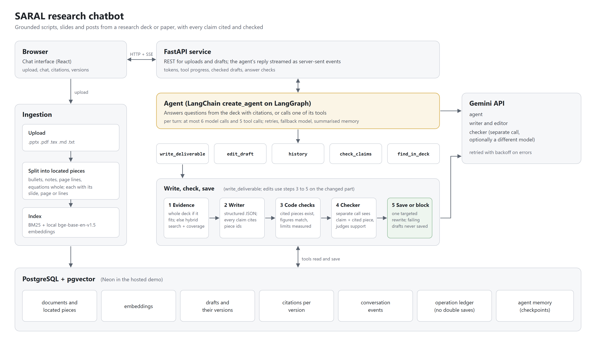

# Architecture

## Ingestion

An upload (`.pptx`, `.pdf`, Beamer or paper `.tex`, `.md`, `.txt`) is parsed into
pieces: one bullet, table row, speaker note, PDF line group or LaTeX equation each.
Every piece keeps its location (slide 4, page 3, lines 12-18), so a citation can
point to it exactly. Equations are kept whole. Pieces are embedded locally with
`BAAI/bge-base-en-v1.5` and stored with a BM25 index in PostgreSQL with pgvector.
The same file uploaded again reuses its stored index.

## The agent

One agent (LangChain `create_agent` on LangGraph, Gemini) owns the conversation. It
answers questions directly from the deck with inline citations, or calls a tool:

| Tool | What it does |
|---|---|
| `write_deliverable` | writes a script, talk, posts or summary through the write, check, save pipeline |
| `edit_draft` | rewrites one part of the current draft, re-checks only that part, saves a new version |
| `history` | undo or redo between saved versions |
| `check_claims` | checks the current draft, or a part of it, against the deck |
| `find_in_deck` | hybrid lookup of exact bullets (BM25 + embeddings, reciprocal rank fusion) |

Middleware bounds every turn: at most 6 model calls and 5 tool calls, with
per-tool limits, retries with backoff and a fallback model on provider errors. The
conversation is kept in a PostgreSQL checkpointer, and older turns are summarised
while lasting preferences are kept.

## Write, check, save

1. **Evidence.** A small source goes to the writer whole (up to 60,000 characters).
   A longer one is cut to that budget: 70% by relevance to the request (hybrid
   search), the rest spread across sections so none is skipped.
2. **Write.** The writer returns structured JSON. Every factual sentence must cite
   piece ids; explanation is marked as background.
3. **Code checks.** Cited pieces must exist, every figure in a sentence must appear
   in its cited piece, and the user's stated limits (length, count) are measured.
4. **Checker.** A second model call sees only each claim and the pieces it cites and
   judges support. Uncited sentences are reviewed as general knowledge.
5. **Save or block.** A failing draft gets one targeted rewrite. If it still fails,
   it is shown as a draft and not saved.

Drafts are versioned. Edits change only the targeted units and are checked the
same way before a new version is saved.

## Streaming

`POST /api/chat/stream` sends server-sent events: tokens of the agent's reply, tool
progress steps, the checked draft, the answer check and a final summary of latency
and tokens. A turn can be stopped from the interface.

## Storage

PostgreSQL with pgvector holds documents, pieces, embeddings, drafts and their
versions, citations, conversation events, an operation ledger and the agent's
checkpoints. Every tool call is recorded in the ledger by its id, so a retried call
never saves twice.
